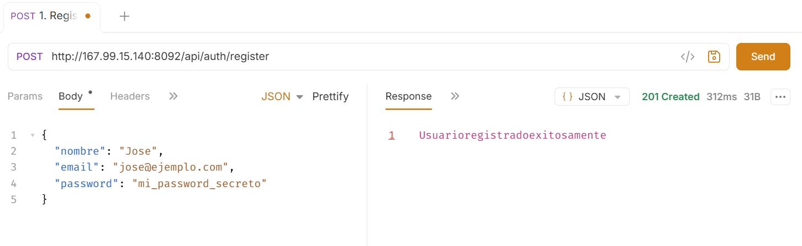
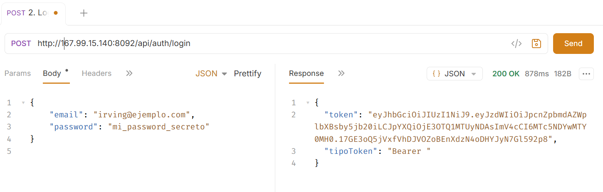
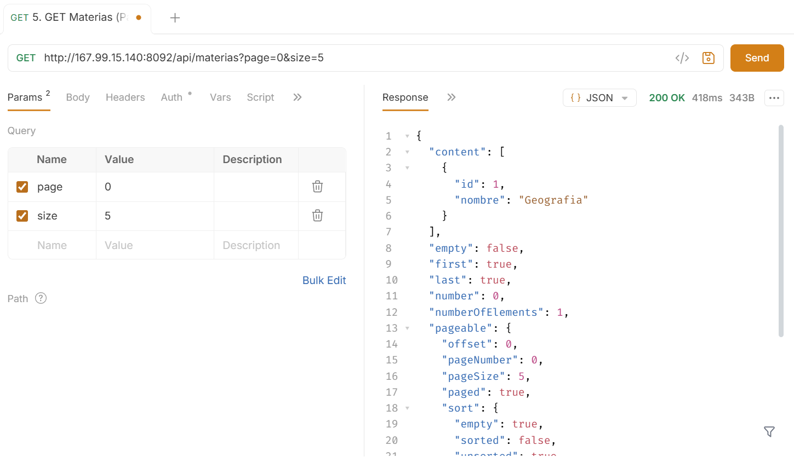
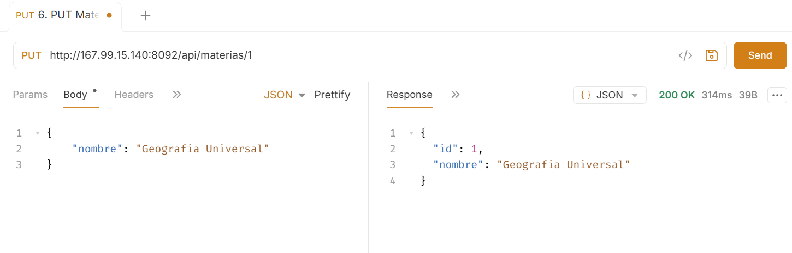
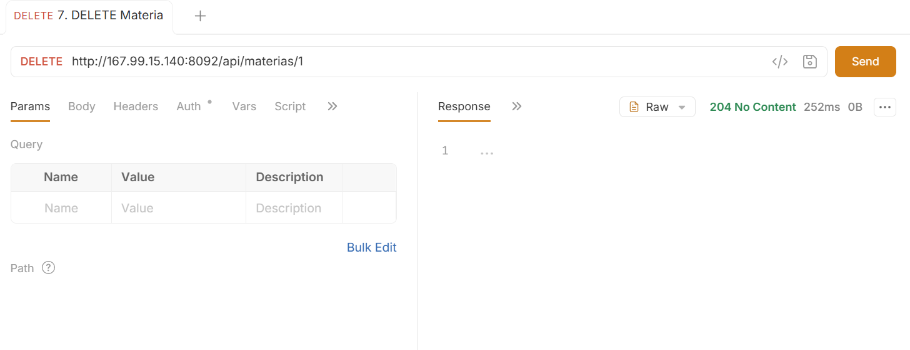

# Actividad 4: API REST con Spring Boot, Spring Security y JWT

Este proyecto es una API REST construida con SpringBoot y MySQL. Implementa autenticación mediante JSON Web Tokens (JWT) y Spring Security. Incluye validación de datos (Bean Validation), uso de DTOs para la transferencia de información, y respuestas con códigos de estado HTTP apropiados.

La colección de pruebas de **Bruno** está incluida en la carpeta `/bruno` de este repositorio.

## Endpoints de Autenticación (Públicos - No requieren Token)

### Registro de Usuario (`POST /api/auth/register`)
Registra un nuevo usuario en la base de datos con contraseña encriptada (BCrypt).

### Login de Usuario (`POST /api/auth/login`)
Autentica al usuario y devuelve el token JWT válido por 24 horas.

---

## Endpoints del CRUD - Entidad Materia (Privados - Requieren Token JWT)

## 2. Endpoints del CRUD - Materias (Privados - Requieren JWT)
*Todas estas peticiones incluyen el token JWT en el header `Authorization: Bearer <token>`. Si no se incluye, la API responderá con un error `403 Forbidden`*

### Crear Materia (`POST /api/materias`)
Valida mediante DTO que los datos no estén vacíos. Devuelve código 201 Created.

### Leer Materias (`GET /api/materias`)
Devuelve la lista de materias implementando paginación. Devuelve código 200 OK.

### Actualizar Materia (`PUT /api/materias/{id}`)
Actualiza los datos de una materia existente. Devuelve código 200 OK.

### Eliminar Materia (`DELETE /api/materias/{id}`)
Elimina el registro de la base de datos. Devuelve código 204 No Content.
